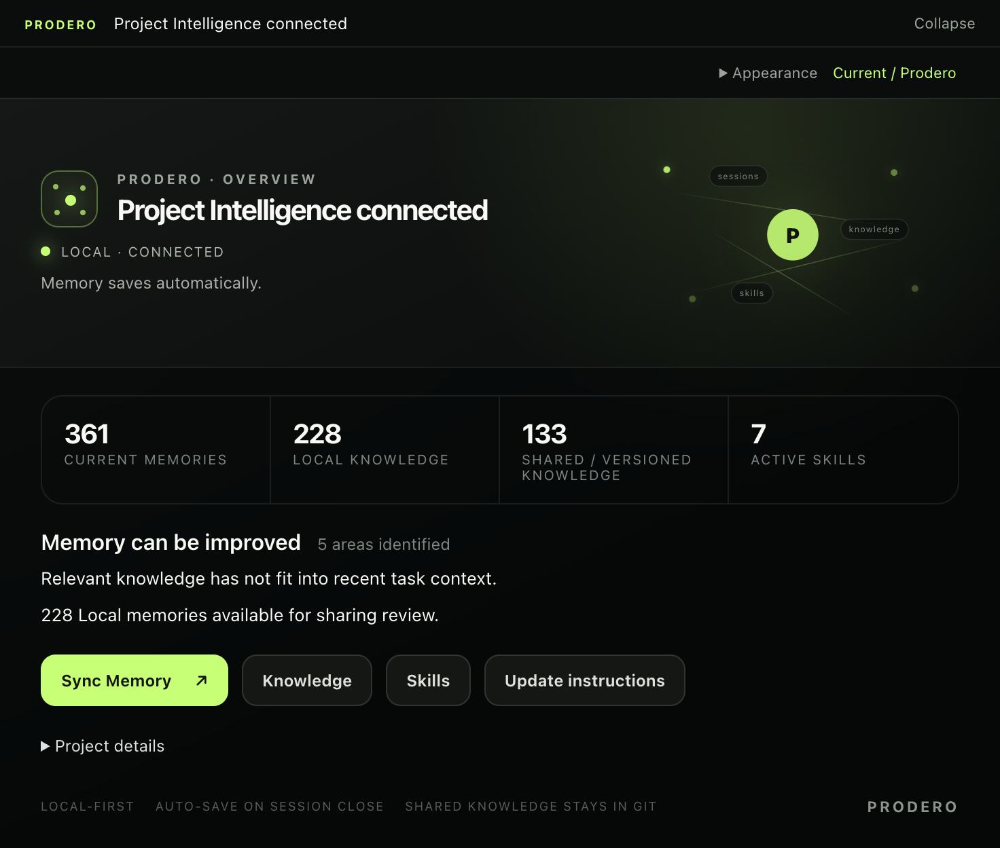
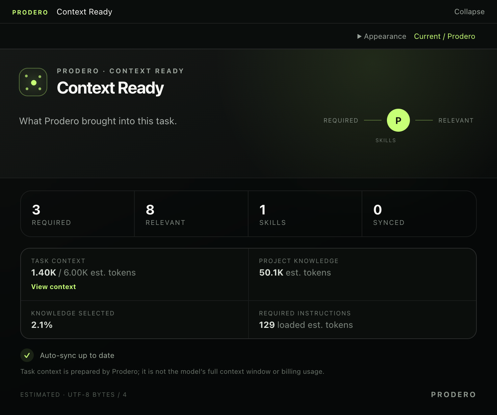
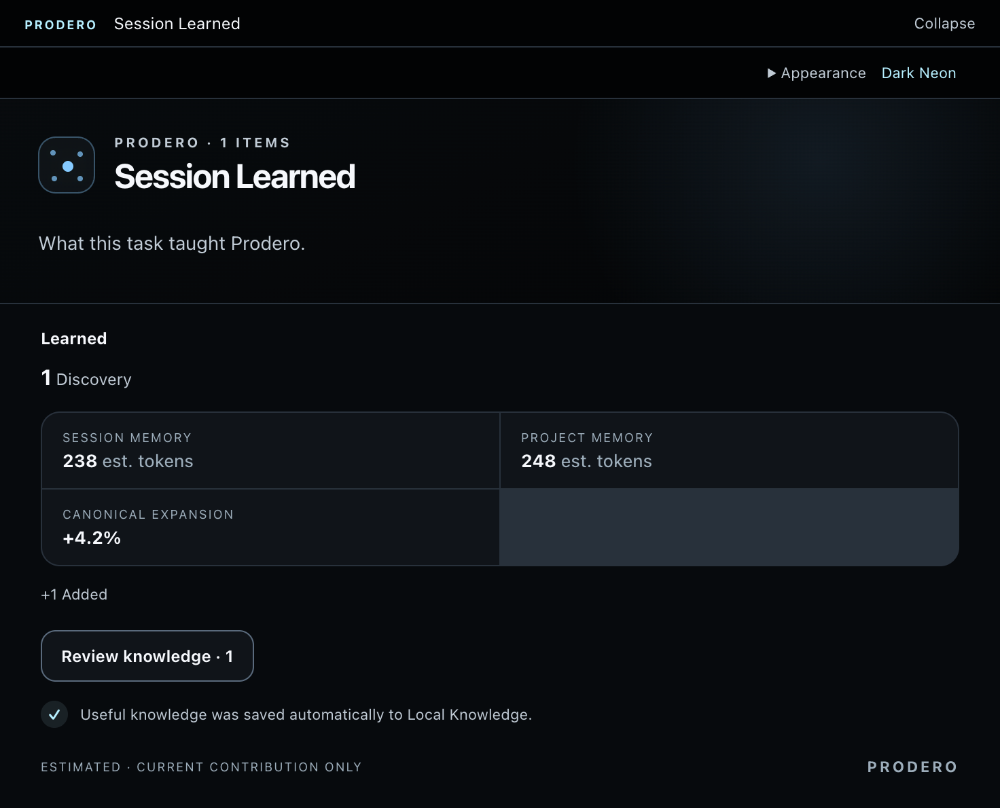

# Prodero Curator

**Project memory for Codex and Claude Code.**

Keep project decisions, conventions, and lessons across sessions, right inside your coding assistant.

**Install in two commands → open Codex or Claude Code → type prodero.**

```sh
npm install --global @prodero/curator@0.1.0
prodero install
```

Requires **Node.js >=22.14.0 <23**, npm and Git. **v0.1.0 Public Preview.** Codex CLI is verified; Claude Code is experimental.

1. In the installation wizard, select **Codex** or **Claude Code**, confirm the setup and choose **Finish**.
2. Reopen Codex or Claude Code in your repository and type **`prodero`** in chat.
3. For a new project, choose **Initialize Prodero** and review the generated project files and Git-ignore rules.

For Claude Code, also create or update the project’s `CLAUDE.md` to import `@AGENTS.md`. The installer does not create that file. See the [setup guide](docs/hosts.md).



## Relevant context, automatically

Just describe your task in Codex or Claude Code. Curator automatically brings in relevant project knowledge and skills as part of the task workflow. No separate search or manual context selection needed.



## Carry lessons into the next session

As Codex or Claude Code closes a session through Curator’s workflow, recorded outcomes automatically become Local Knowledge. Curator can bring those lessons into later tasks when they are relevant. You can inspect and edit saved knowledge at any time.



Curator relies on Codex or Claude Code following its runtime instructions to prepare tasks, record useful outcomes and close sessions. It does not watch every conversation or guarantee that every detail will be remembered.

## Everyday use

Everyday work happens in conversation with Codex or Claude Code; the terminal is for installation and maintenance.

- “What do we know about our API test setup?”
- “Remember that API tests should use our shared fixtures. Apply this to the `tests/` path.”
- “Update the saved testing convention to use the new fixture directory.”
- “Review which Local lessons would be useful to share with the team.”

Use **Knowledge** to search, inspect and edit saved items. **Sync Memory** lets you choose **Improve memory**, **Share knowledge**, or both, then start the workflow. Eligible Local improvements can apply within that workflow; sharing presents proposed Versioned changes for review. Normal session learning does not require running Sync Memory.

Where the host supports MCP Apps, Curator provides a graphical interface. Otherwise, use text mode: **“Show Prodero as text.”** You do not need to memorize CLI commands.

## Main capabilities

- **Task context:** bounded selection of relevant knowledge and reusable skills.
- **Session continuity:** recorded outcomes become Local Knowledge when sessions close; preparation can recover pending observations.
- **Knowledge management:** search, applicability, sources, relationships and revision-aware editing.
- **Skills:** reusable procedures, with Local candidates and review workflows for Versioned skills.
- **Team knowledge:** Git-shareable Markdown that you review alongside repository changes.

## Local and Versioned Knowledge

**Local Knowledge** is Git-ignored working state. **Versioned Knowledge** is Git-shareable project state. Curator retrieves both; cloning a repository brings committed Versioned Knowledge, not ignored Local data.

Local does **not** mean inaccessible to the connected agent. The agent may create, promote and maintain Versioned Knowledge. Review and approval steps are workflow safeguards, not authenticated human authorization. Curator does not commit or push: review repository changes before sharing them.

The generated `.prodero/index.md` can include active **Local skill titles and paths**. It is not automatically ignored in every project. Keep it ignored when those details are private, and review generated files before committing. See [storage and privacy](docs/PRIVACY.md).

## Compatibility and limitations

**Codex CLI is verified; Claude Code is experimental.** Codex desktop has been used during development with MCP Apps, but artifact-host UI interaction has not yet been independently verified. Cursor is detection-only, and there is no Claude Desktop installer.

MCP Apps, workspace roots and sampling support vary by host. Text mode supports core workflows, but App-only curation review/apply is unavailable through the text gateway. See the [host/runtime matrix](docs/COMPATIBILITY.md) and [setup guide](docs/hosts.md).

## Privacy and security

Knowledge and session history are plaintext project files. Keep secrets out of Curator: credential screening is best-effort, not complete data-loss prevention. Forgetting an item does not securely erase history, backups or Git.

Retrieved context reaches your connected agent. Optional assisted operations can send selected content through host sampling to its model; deterministic workflows do not require sampling. Curator requires neither cloud synchronization nor embeddings. See [privacy](docs/PRIVACY.md) and [security reporting](SECURITY.md).

## Documentation and contributing

- [Setup, updates and advanced CLI commands](docs/hosts.md) · [Recovery](docs/RECOVERY.md)
- [Architecture](ARCHITECTURE.md) · [Context selection](docs/CONTEXT-SELECTION-V2.md)
- [Themes](docs/ui-themes.md) · [Plugins](docs/plugins.md)
- [Contributing](CONTRIBUTING.md) · [Changelog](CHANGELOG.md) · [Release verification](docs/RELEASING.md)

Preview interfaces and schemas may evolve. Back up the whole `.prodero` directory before upgrading; follow the linked maintenance and recovery guidance.

Curator is [MIT licensed](LICENSE).
