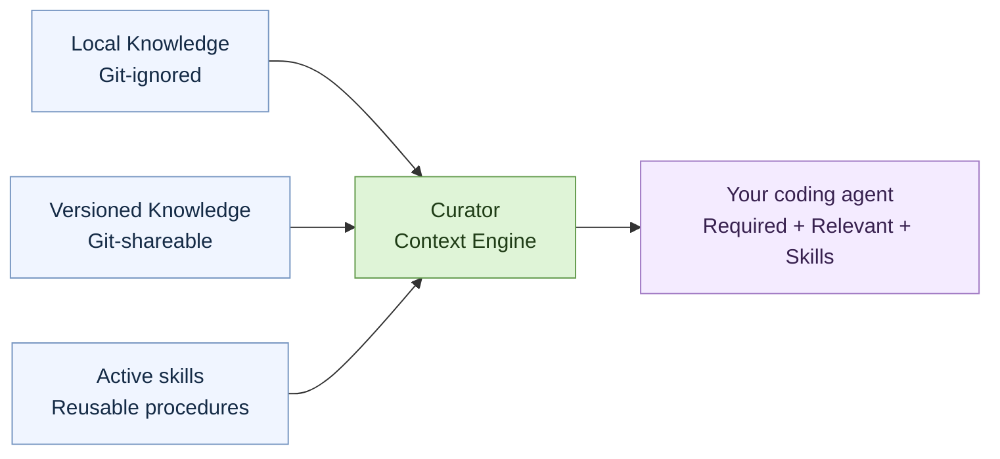
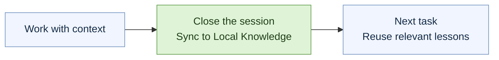
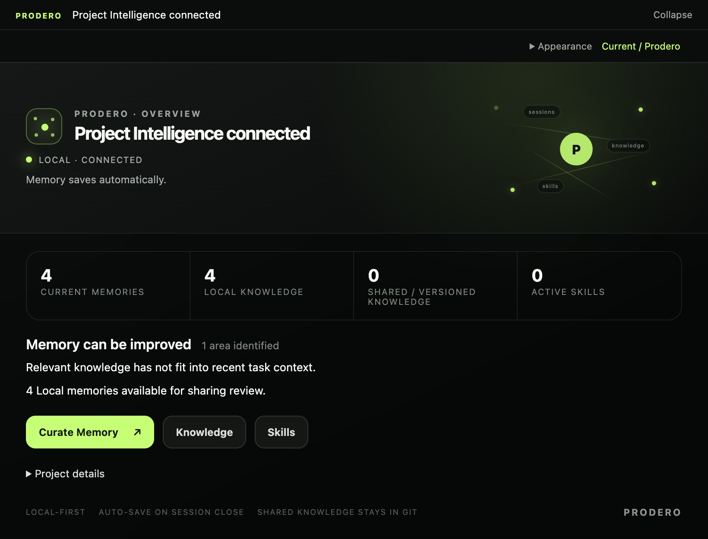
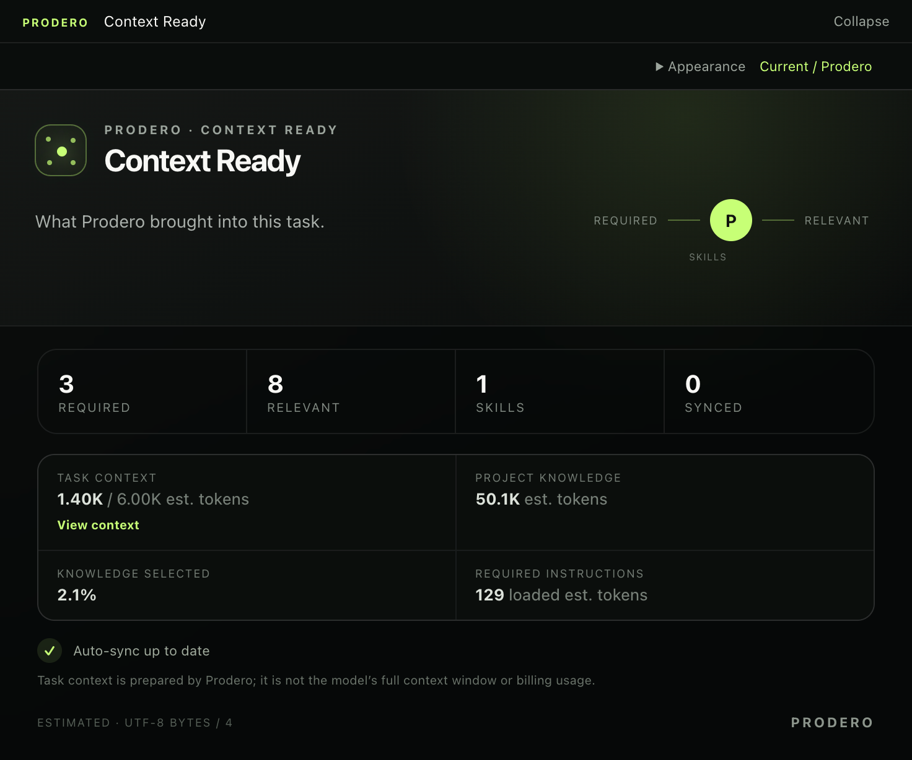
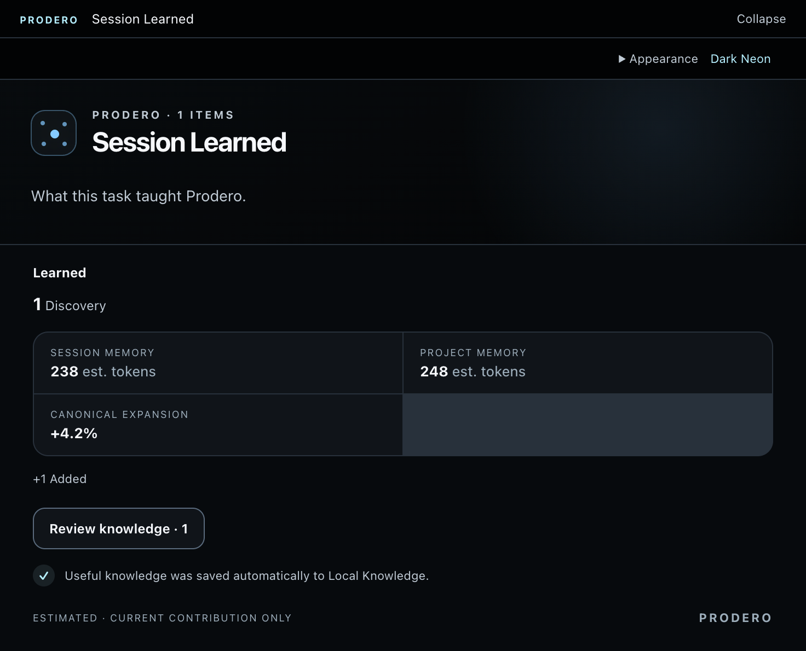

# Prodero Curator

**Project memory for Codex and Claude Code.**

**0.3.0 Public Preview.** See [compatibility and verification](docs/COMPATIBILITY.md) for the exact coverage and limitations.

Keep project decisions, conventions, and lessons across sessions, right inside your coding assistant.

## Install with a prompt

Paste this into your coding agent:

```text
Install Prodero Curator using https://prodero.io/curator/setup.md
```

The guide covers Codex and experimental Claude Code: it inspects your setup, proposes one concrete plan and verifies the selected client's connection. See the [publication handoff](docs/INSTALL-WITH-AGENT.md). [Manual installation](#manual-installation) remains available.

## Manual installation

Install in two commands, reopen your coding client, then type **`prodero`**.

```sh
npm install --global @prodero/curator@0.3.0
prodero install
```

Requires **Node.js >=22.14.0 <23**, npm and Git. **v0.3.0 Public Preview.** Claude Code remains experimental; native-client coverage is recorded by version below. See the [compatibility matrix](docs/COMPATIBILITY.md).

1. In the installation wizard, select **Codex** or **Claude Code**, confirm the setup and choose **Finish**.
2. Reopen Codex or Claude Code in your repository and type **`prodero`** in chat.
3. For a new project, choose **Initialize Prodero** and review the generated project files and Git-ignore rules.

For Claude Code, also create or update the project’s `CLAUDE.md` to import `@AGENTS.md`. The installer does not create that file. See the [setup guide](docs/hosts.md).

## How Curator helps

### Project memory, selected for the task

One Context Engine selects bounded context from Local and Versioned Knowledge and active skills. Your agent gets the relevant project background instead of the whole memory store.



Local Knowledge stays Git-ignored; Versioned Knowledge can travel with reviewed Git changes. Curator retrieves both and does not commit or push.

### Recorded lessons can help the next task

When your agent records useful outcomes and closes the session with synchronization, Curator can bring the resulting Local Knowledge into later tasks.



This follows the agent's Prepare → Record → Close workflow; Curator does not watch every conversation or save unrecorded details.



*Current Curator App with demonstration project data.*

## Relevant context, automatically

Just describe your task in Codex or Claude Code. Curator automatically brings in relevant project knowledge and skills as part of the task workflow. No separate search or manual context selection needed.



## Carry lessons into the next session

As Codex or Claude Code closes a session through Curator’s workflow, recorded outcomes automatically become Local Knowledge. Curator can bring those lessons into later tasks when they are relevant. You can inspect and edit saved knowledge at any time.



Curator relies on Codex or Claude Code following its runtime instructions to prepare tasks, record useful outcomes and close sessions. It does not watch every conversation or guarantee that every detail will be remembered.

## Everyday use

Everyday work happens in conversation with Codex or Claude Code; the terminal is for installation and maintenance.

- “What do we know about our API test setup?”
- “Remember that API tests should use our shared fixtures. Apply this to the `tests/` path.”
- “Update the saved testing convention to use the new fixture directory.”
- “Review which Local lessons would be useful to share with the team.”

Use **Knowledge** to search, inspect and edit saved items. Explicit Open also offers **Curate Memory** and **Local → Versioned**: preview current knowledge, select exact changes or records, and approve before applying. Curator handles ordinary memory maintenance during work; there is no memory moderation dashboard or routine review queue. Bounded conflicts can be analyzed by the current session's coding agent. Deterministic checks preserve original evidence and protected rules when a safe change cannot be established. Only a decision that actually blocks the current task needs the user's input.

The [maintenance contract](docs/V0.3.0-MAINTENANCE.md) describes automatic work, conservative retention and the remaining safety boundaries.

Where the host supports MCP Apps, Curator provides a graphical interface. Otherwise, use text mode: **“Show Prodero as text.”** In 0.3.0, chat uses compact native Markdown with a small `›_ prodero` launch mark and brief task/save updates. The terminal keeps its own renderer. See [text behavior and examples](docs/V0.3.0-CHAT-TEXT.md). You do not need to memorize CLI commands.

## Main capabilities

- **Task context:** bounded selection of relevant knowledge and reusable skills.
- **Session continuity:** recorded outcomes become Local Knowledge when sessions close; preparation can recover pending observations.
- **Knowledge management:** search, applicability, sources, relationships and revision-aware editing.
- **Skills:** reusable procedures, with Local candidates and review workflows for Versioned skills.
- **Team knowledge:** Git-shareable Markdown that you review alongside repository changes.

## Local and Versioned Knowledge

**Local Knowledge** is Git-ignored working state. **Versioned Knowledge** is Git-shareable project state. Curator retrieves both; cloning a repository brings committed Versioned Knowledge, not ignored Local data.

Local does **not** mean inaccessible to the connected agent. The agent may create, promote and maintain Versioned Knowledge. Review and approval steps are workflow safeguards, not authenticated human authorization. Curator does not commit or push: review repository changes before sharing them.

The generated `.prodero/index.md` can include active **Local skill titles and paths**. It is not automatically ignored in every project. Keep it ignored when those details are private, and review generated files before committing. See [storage and privacy](docs/PRIVACY.md).

## Compatibility and limitations

Codex CLI and Claude Code were tested with text workflows. The maintainer also reported successful manual checks in Codex Desktop, Claude CLI and Codex Mobile. Claude Code remains experimental; Cursor is detection-only, and there is no Claude Desktop installer. Tested versions and the scope of these checks are listed in the [compatibility matrix](docs/COMPATIBILITY.md).

MCP Apps, workspace roots and sampling support vary by host. Text mode supports core workflows; explicit edits, sharing and Required-policy decisions retain their safety checks. Legacy maintenance APIs remain technical compatibility interfaces. See the [host/runtime matrix](docs/COMPATIBILITY.md) and [setup guide](docs/hosts.md).

## Privacy and security

Knowledge and session history are plaintext project files. Keep secrets out of Curator: credential screening is best-effort, not complete data-loss prevention. Forgetting an item does not securely erase history, backups or Git.

Retrieved context reaches your connected agent. Optional assisted operations can send selected content through host sampling to its model; deterministic workflows do not require sampling. Curator requires neither cloud synchronization nor embeddings. See [privacy](docs/PRIVACY.md) and [security reporting](SECURITY.md).

## Documentation and contributing

- [Setup, updates and advanced CLI commands](docs/hosts.md) · [Recovery](docs/RECOVERY.md)
- [Architecture](ARCHITECTURE.md) · [Context selection](docs/CONTEXT-SELECTION-V2.md)
- [Themes](docs/ui-themes.md) · [Plugins](docs/plugins.md)
- [Contributing](CONTRIBUTING.md) · [Changelog](CHANGELOG.md) · [Release verification](docs/RELEASING.md)

Preview interfaces and schemas may evolve. Back up the whole `.prodero` directory before upgrading; follow the linked maintenance and recovery guidance.

Curator is [MIT licensed](LICENSE).

### Updating the installed core

Codex/Claude show an available-version indicator and terminal instructions only. Run `prodero update` in your terminal, finish active work and close the hosts when prompted, then explicitly confirm. Restart the hosts after completion. The built-in updater supports a same-user global npm installation with **npm 10.9.x**; use your package manager for other installation layouts or toolchains. Project knowledge migration is offered separately on Open/Prepare; package update preserves saved dev selection and preferences. See [update and non-interactive options](docs/hosts.md#updates-and-advanced-project-commands).
